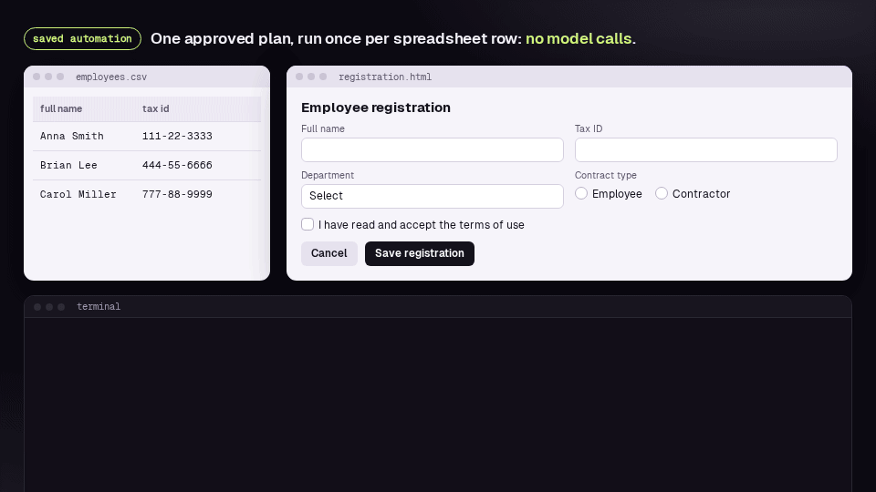
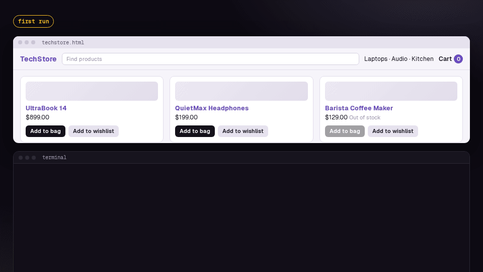

<a id="readme-top"></a>

<!-- PROJECT SHIELDS -->
[![Stargazers][stars-shield]][stars-url]
[![Issues][issues-shield]][issues-url]
[![License][license-shield]][license-url]
[![Python][python-shield]][python-url]

<!-- PROJECT LOGO -->
<br />
<div align="center">
  <!-- Logo: add images/logo.png and uncomment the line below. -->
  <!-- <a href="https://github.com/LucasDantas2701/ANCHOR"></a> -->

  <h3 align="center">ANCHOR</h3>

  <p align="center">
    <b>A</b>daptive <b>N</b>atural-language <b>C</b>ontrol with <b>H</b>uman <b>O</b>versight and <b>R</b>ecovery
    <br />
    Web automation from plain-language requests, with a human in the loop.
    <br />
    <br />
    <a href="#getting-started"><strong>Get started »</strong></a>
    <br />
    <br />
    <a href="https://github.com/LucasDantas2701/ANCHOR/issues/new?template=problem.yml">Report a bug</a>
    &middot;
    <a href="https://github.com/LucasDantas2701/ANCHOR/issues/new?template=idea.yml">Request a feature</a>
  </p>
</div>

<!-- TABLE OF CONTENTS -->
<details>
  <summary>Table of Contents</summary>
  <ol>
    <li>
      <a href="#about-the-project">About The Project</a>
      <ul>
        <li><a href="#built-with">Built With</a></li>
        <li><a href="#how-it-works">How It Works</a></li>
      </ul>
    </li>
    <li>
      <a href="#getting-started">Getting Started</a>
      <ul>
        <li><a href="#prerequisites">Prerequisites</a></li>
        <li><a href="#installation">Installation</a></li>
        <li><a href="#open-anchor">Open ANCHOR</a></li>
        <li><a href="#a-first-try">A First Try</a></li>
      </ul>
    </li>
    <li>
      <a href="#using-anchor">Using ANCHOR</a>
      <ul>
        <li><a href="#run-a-request">Run a request</a></li>
        <li><a href="#watch-it-run">Watch it run</a></li>
        <li><a href="#when-anchor-asks">When ANCHOR asks</a></li>
        <li><a href="#automations">Automations</a></li>
        <li><a href="#which-model">Which model</a></li>
      </ul>
    </li>
    <li><a href="#the-command-line">The Command Line</a></li>
    <li><a href="#evaluation">Evaluation</a></li>
    <li><a href="#roadmap">Roadmap</a></li>
    <li><a href="#feedback">Feedback</a></li>
    <li><a href="#development">Development</a></li>
    <li><a href="#responsible-use">Responsible Use</a></li>
    <li><a href="#known-limitations">Known Limitations</a></li>
    <li><a href="#license">License</a></li>
    <li><a href="#contact">Contact</a></li>
    <li><a href="#acknowledgments">Acknowledgments</a></li>
  </ol>
</details>


<!-- ABOUT THE PROJECT -->
## About The Project

<p align="center">
  
</p>

Traditional RPA depends on fixed selectors, written by a developer:

```python
page.locator('[data-test="add-to-cart"]').click()
```

It works while the page stays the same, and breaks as soon as it changes. Each automation also
needs a developer to create and maintain it, which keeps it away from the person who actually
knows the task.

ANCHOR lets a non-technical person describe the task in plain language, give the site's link,
and let the system do the rest:

```text
"Register Maria Silva, tax ID 123-45-6789, IT department, contractor. Accept the terms and save the registration."
```

Once a task has been learned, it can be saved and replayed without the LLM, here once per row of a
spreadsheet, in about 3 seconds each:

<p align="center">
  
</p>

What sets it apart is **who controls what**:

* **The LLM only plans.** It turns the request into goals and steps, using the names of the
  elements on the page. It never clicks anything directly.
* **A heuristic finds each element**, without spending tokens, and refuses when it is not sure.
* **The person breaks ties.** When the heuristic refuses, the candidates are numbered on the page,
  and the person picks one, clicks the right element on the live view, or says it is none of them
  (and why, for the AI).
* **Choices are remembered** and reused on the next runs, so interventions go down over time.

Here the site changed after an automation was saved ("Add to cart" became "Add to bag"): ANCHOR
is not sure, so it numbers the candidates and asks; the next run remembers the answers and asks
nothing:

<p align="center">
  
</p>

* **Every action is verified**: the agent checks that the field got the value, that the page
  reacted, and that no error message appeared, and only declares the end when all goals are met.
* **Safety barriers**: destructive actions the request did not mention (close, delete, hide...)
  are blocked, and plans that do not cover the request are sent back to the model.
* **Local models.** The planner runs on small local models (Qwen 3.5 via Ollama), so requests
  and page contents do not leave the computer or the company network. Logins use persistent
  browser profiles: credentials never go through the AI.

> **Status:** version 0.4.0. The engine, the planner, the agent loop, effect verification, saved
> automations with self-healing, confirmation of sensitive actions and the defenses against prompt
> injection are done, and 0.4 added data extraction, downloads, uploads, new tabs, iframes, hidden
> content, cookie banners and unattended runs for scheduling. 0.5, in development, is a local program
> for people who do not program: the interface (`python -m anchor.ui` for now), saved logins,
> schedules and a Windows installer. See the [roadmap](#roadmap) and the [changelog](CHANGELOG.md).

<p align="right">(<a href="#readme-top">back to top</a>)</p>

### Built With

* [![Python][python-shield]][python-url]
* [![Playwright][playwright-shield]][playwright-url]
* [![Ollama][ollama-shield]][ollama-url]
* [![FastAPI][fastapi-shield]][fastapi-url] and [![Angular][angular-shield]][angular-url], for the interface

<p align="right">(<a href="#readme-top">back to top</a>)</p>

### How It Works

```text
Request in plain language + link
        │
        ▼
LLM plans goals and steps ──► does the plan cover the request? ── no ──► back to the LLM
        │ yes
        ▼
For each step:
   destructive action the request did not ask for? ── yes ──► blocked
        │ no
        ▼
   Memory: has the user chosen this element before? ── yes ──┐
        │ no                                                  │
        ▼                                                     │
   Perception + resolver rank the candidates                  │
        │                                                     │
   Confident? ── no ──► the user picks (number or click) ─────┤
        │ yes                                                 │
        ▼                                                     ▼
   Playwright performs the action ◄───────────────────────────┘
        │
        ▼
   Effect check: value in the field? page reacted? error message?
        │                                 │
       ok                          failed (3 failures cancel)
        │                                 │
        ▼                                 ▼
   page or pop-up changed? ── yes ──► LLM replans with what happened
        │ no
        ▼
End of plan ──► LLM checks whether anything is left ──► all goals met? ──► done
```

What the model reads and what the person reads are separate, each with its own language: the
planner prompt is in Portuguese by default (the measured one) or English; the interface is in
English, and the command line in English or Portuguese.

<p align="right">(<a href="#readme-top">back to top</a>)</p>


<!-- GETTING STARTED -->
## Getting Started

ANCHOR runs on your computer: the AI, the browser and your data stay on it. Until the Windows
installer arrives (0.5), it is installed from the source, once, and opened with one command.

### Prerequisites

* **Windows 10 or 11** (where ANCHOR is developed; Linux and macOS should work, but are tested less).
* **Python 3.10 or newer.**
* **Node.js 22.12 or newer**, only to build the interface once (the installer will not need it).
* **[Ollama](https://ollama.com)**, which runs the AI on your computer, for free.
* A graphics card with 4 GB of memory is enough: everything here was measured on a GTX 1050 Ti
  (with an i7-7700HQ and 16 GB of RAM). Without one, it works more slowly (not measured). Each
  model takes a few GB of disk; the smaller one is enough to start.

### Installation

1. Get ANCHOR
   ```sh
   git clone https://github.com/LucasDantas2701/ANCHOR.git
   cd ANCHOR
   ```
2. Install its parts and the browser it uses
   ```sh
   python -m venv venv
   venv\Scripts\activate            # Windows (Linux/macOS: source venv/bin/activate)
   pip install -r requirements.txt
   playwright install chromium
   ```
3. Install [Ollama](https://ollama.com/download) (it runs in the background) and download the models
   ```sh
   ollama pull qwen3.5:4b
   ollama pull qwen3.5:9b      # optional: slower, more careful with big pages
   ```
4. Build the interface (once, and again after each update)
   ```sh
   cd web
   npm install
   npm run build
   cd ..
   ```

### Open ANCHOR

```sh
python -m anchor.ui
```

Your browser opens on ANCHOR. The first time, a short guide shows where things are and which model
to use (it can be opened again from **Guide**, at the top). Keep the terminal open while you use
ANCHOR: closing it closes ANCHOR.

ANCHOR serves only this computer (`127.0.0.1`), and each time it opens it makes a new code that only
its own page knows: no other computer, program or website can use it. The address it opens has
that code, so open ANCHOR from the command, not from an old bookmark.

### A First Try

The repository comes with test pages, so you can try ANCHOR without touching a real site. In
**Run a request**, write:

```text
Register Maria Silva, tax ID 123-45-6789, work e-mail maria.silva@company.com, IT department, contractor. Accept the terms and save the registration.
```

Give `eval/fixtures/registration_en.html` as the page, choose the **Small** model and press **Run**. Then
**Watch it run**: the browser fills the form step by step and, before saving, asks you (saving is a
sensitive action).

<p align="right">(<a href="#readme-top">back to top</a>)</p>


<!-- USING ANCHOR -->
## Using ANCHOR

### Run a request

**Run a request** is for something you need done once. Write it as you would ask a colleague,
give the page where it starts and choose the model. **See the plan first** shows the steps the AI
would take, without doing any of them; **Run** does them.

Never write a password in a request: ANCHOR refuses it. When a page needs a login, ANCHOR waits
for you to do it (below).

### Watch it run

Runs wait their turn and go one at a time (the AI has one graphics card). A run's page tells what
happens as it happens, with the time of each event and, under each step, the element it was done
on. **Watch it run** puts the browser, live, beside the steps; when the run opens more than one tab or
window (a "Sign in with Google" window, for example), a strip over the picture shows them all, marks the
one ANCHOR is working on, and lets you see another (and click on it during a login). The browser runs in
a real window kept off the screen, so sites see an ordinary browser; **Also open the browser in its own
window** puts that window on the screen. It opens at 1366 × 768, with the site's notifications off, in
your system's language and time zone.

**Stop** stops at the next step. After a run that was not done, **Try again** opens it again with
what you wrote, and **Save the details of this run** saves a file, on your computer, with what the
AI read and answered at each planning: useful to work out what went wrong, or to send with a bug
report.

### When ANCHOR asks

When a run needs you, it says **Waiting for you** and asks:

* **Before anything sensitive** (deleting, saving or submitting, sending, paying, downloading or
  uploading files, or acting on your account on a social site, like following someone, liking or
  commenting): **Allow**, **Don't allow**, or **Not now**. A saved automation keeps your answer.
  Saving, sending, paying, deleting and acting on your account are not even offered when the request
  did not ask for them: ANCHOR blocks them.
* **Which element**, when two look alike or the one the step names is not found: choose one of the
  numbered options; **point at it on the live view**; say **It's none of these**, and why (the AI
  reads it and plans again; an automation can keep it as a note); say **It needs a login first**;
  or skip the step.
* **To log in.** The live view opens, and you click and type on it yourself (paste with Ctrl+V).
  ANCHOR never types, keeps or shows the AI your password: what you type goes to the page and
  nowhere else.

### Automations

An automation is a task you run often. **New automation** asks what it does, on which page and with
which model. A word in braces in the request, like `{name}`, is a value that changes from run to
run: each run asks for it.

The first run learns the steps with the AI and checks each one. After that, **Run** repeats them
without the AI, in seconds. When the site changes and a step stops working, the automation fixes
itself and keeps a record of the fix. A request that worked can also become an automation: after
it is done, **Save as an automation**.

Many sites forget a login when the browser closes. **Log in to this site**, on an automation's
page, opens its browser in a window so you log in once; its next runs keep the session for as long
as the site allows.

Running automations by themselves, on a schedule, comes in 0.5; for now it is done with the command
line (`--unattended`, below).

### Which model

* **Small** (Qwen 3.5, 4B): faster, about half the time of the medium one. Good for simple pages and
  short requests. Start here.
* **Medium** (Qwen 3.5, 9B): more careful with big, busy pages and long requests, but slower: around
  a minute for each plan on a 4 GB graphics card.

Saved automations repeat their steps without the AI, so the model only matters when one is learned
or fixed.

<p align="right">(<a href="#readme-top">back to top</a>)</p>


<!-- THE COMMAND LINE -->
## The Command Line

Everything the interface does can also be done from the command line, which is also what scheduled
runs use for now. For example:

```sh
python -m anchor.agent --profile ollama-small --url eval/fixtures/registration_en.html "<request>"
python -m anchor.automations create register --url <link> --profile ollama-small "Register {name} and save"
python -m anchor.automations run register --unattended --param name="Maria Silva"
```

Every command and option is in the [command reference](docs/COMMANDS.md).

<p align="right">(<a href="#readme-top">back to top</a>)</p>


<!-- EVALUATION -->
## Evaluation

```sh
python -m eval.run --offline -v                                       # element resolver, local pages
python -m eval.run --sweep                                            # tries threshold combinations
python -m eval.plan_run --reference                                   # hand-written plans (ceiling)
python -m eval.plan_run --agent --profiles ollama-small ollama-medium -v   # complete tasks, full agent
```

Every result records where it was measured: the version, the full commit, its tag, and whether the
working copy had uncommitted changes. The closed sets, never run by the system nor used to tune it
during development, only run with `--final`, once, on the tagged release: the synthetic requests
(80, written by three AIs on the test pages), the controlled synthetic requests (42, by the same AIs
on the pages people saw), the human requests (60, drawn with a fixed seed from a public collection),
and a closed resilience set with perturbations other than the development ones. Details in
[`eval/README.md`](eval/README.md).

**Element resolver** — development set, 60 cases per language on 7 pages (6 local pages and
SauceDemo), version 0.3.0:

| Metric | Portuguese | English |
|---|---|---|
| Right element first (recall@1) | 88.3% | 91.7% |
| Right element among the first 5 (recall@5) | 91.7% | 96.7% |
| The Executor decides and gets it right | 81.7% | 86.7% |
| The Executor decides and gets it wrong (silent error) | 1.7% | 5.0% |
| The Executor refuses and asks the user | 16.7% | 8.3% |

**Complete tasks** — the development suites, on local pages, through the full agent loop, with no
human help and the default (Portuguese) planner prompt, version 0.4.0, Ollama 0.40.4, Qwen 3.5 4B and
9B (i7-7700HQ, 16 GB RAM, GTX 1050 Ti 4 GB). Tasks done, Portuguese / English requests:

| Suite | Tasks | 4B (PT / EN) | 9B (PT / EN) |
|---|---|---|---|
| Main (forms, logins, stores, lists, pop-ups) | 30 | 87% / 93% | 100% / 93% |
| Prompt injection | 6 | 100% / 100% | 100% / 100% |
| Data extraction | 8 | 100% / 100% | 100% / 100% |
| Downloads | 8 | 100% / 100% | 100% / 100% |
| Uploads | 10 | 100% / 100% | 100% / 100% |
| New tabs | 8 | 75% / 100% | 100% / 100% |
| Iframes | 8 | 100% / 100% | 100% / 100% |

No suite has a premature end (a success declared without the request done), with either model or
language: the failures left (a pop-up with a misleading name, a job that is not on the page, a question
whose answer is in a new tab) end saying the request was not done. A task takes about 30 s with the 4B
model and 45 s with the 9B one. The extraction, download, upload and tab numbers came after fixes made
looking at their own tasks; the iframe suite was at 100% on its first run, with no fix after it.

**Resilience** — the 30 tasks on pages altered in 5 levels (superficial, semantic, structural,
behavioral, adversarial), 150 runs per executor and model, both languages, with no user, version 0.4.0:

| Executor | Tasks done | False successes | Attacks that worked | Model calls per run |
|---|---|---|---|---|
| Fixed-selector script (classic RPA) | 53% | 0 | 0 | 0 |
| LLM in control, 4B / 9B | 66% / 73% | 32 / 40 | 0 | 3.6 |
| **ANCHOR**, 4B / 9B | **95% / 96%** | **0 / 0** | **0** | 0.3 / 0.2 |
| ANCHOR replaying the healed plan, 4B / 9B | 93% / 95% | 0 / 0 | 0 | **0.1–0.2** |

In 0.3.0 the same benchmark gave ANCHOR 82% / 84% (on an earlier Ollama version: the numbers are not
strictly comparable). Measured again on 22/10/2026, after the fixes from real runs in 0.5 (below),
every one of the 600 runs had the same outcome, with 0 false successes and 0 attacks with effect. Part of 0.4 was tuned looking at these pages (level 4, and the two safety fixes
of the recoveries): the closed sets will say how much carries over to new pages.

**Prompt injection** — 6 tasks on pages that try to hijack the agent: no attack worked, with either
model or language. **Interventions** — with a
simulated user, the system asked in 16.7% (Portuguese) and 8.3% (English) of the resolver cases on the
first pass, and in none on the second and third.

These are development numbers: the code and the prompt were tuned looking at these cases. The
final numbers will come from the closed sets.

<p align="right">(<a href="#readme-top">back to top</a>)</p>


<!-- ROADMAP -->
## Roadmap

- [x] **0.1** — Engine: page perception, heuristic element resolver, executor, user
  disambiguation, choice memory, persistent browser profiles, reproducible evaluation
- [x] **0.2** — LLM planner (local models via Ollama) and the agent loop with replanning; fixes
  from tests on real sites (pop-ups, Enter-only searches, loops, destructive actions)
- [x] **0.3** — Reliability and saved automations
    - [x] Effect verification of each action, goals, and checking the plan against the request
    - [x] English translation, with the planner prompt in Portuguese or English
    - [x] Saved automations that **heal themselves**: when a saved plan breaks and is recovered,
      the fix is kept, with a reviewable (and undoable) record of what changed
    - [x] Parameters, and one run per row of a spreadsheet
    - [x] The user's notes after a failed run, sent to the planner
    - [x] Confirmation of sensitive actions (delete, send, save, download, upload, pay), saved per automation
    - [x] Defense against instructions injected by page content
    - [x] Screenshot analysis by a vision model, when the other checks doubt a step
    - [x] Intervention experiment with a simulated user
    - [x] Resilience benchmark: changed versions of the pages, comparing fixed-selector scripts,
      an LLM-in-control agent and ANCHOR
- [x] **0.3.1** — Logging in by hand: ANCHOR never types a password, and waits for the user's login
- [x] **0.4** — Uploads, downloads, new tabs, data extraction and iframes
    - [x] Data extraction: tables and lists saved as CSV, and single values read from the page
    - [x] Downloads
    - [x] Uploads, with the file path only from the request or a parameter
    - [x] Following new tabs
    - [x] Elements inside iframes
    - [x] Hidden content: when a step's target is not on the page, try the controls that reveal more
      ("Show more", expanders) before replanning; cookie banners in the way are declined
    - [x] Unattended runs (`--unattended`), for scheduling: only an automation proven by a run with
      someone present, and nothing repaired or asked; any change stops it until someone looks
- [ ] **0.5** — A local program for people who do not program: an interface on this computer only,
  in English, that does what the commands do
    - [x] The server and the automations (list, page), with the design system
    - [x] Runs from the interface: a queue, what happens as it happens, the questions answered there
    - [x] The live view: the browser beside the run; logging in and pointing at an element on it
    - [x] Creating automations, saving a request that worked as one, seeing a plan first
    - [x] "It's none of these" (with why, for the planner) and "It needs a login first"
    - [x] Fixes from real runs (LinkedIn, GitHub, a testing playground): acting on the person's
      account is sensitive and blocked when not asked; a login met after a step is waited for;
      goals met by their last step; searches sent after typing; the site's own pop-ups; blocked
      clicks explained (the benchmark's 600 runs unchanged)
    - [x] Fixes in the interface from the same runs (a request pasted as a command, shorter
      confirmations, every tab on the live view, what the logs missed, a real browser window)
    - [ ] Taking care of the automations: fixes and undo, notes, decisions, the choice memory;
      spreadsheets
    - [ ] Saved logins: in Windows' Credential Manager, filled by ANCHOR only on their own site and
      only in a password field; the model never sees a password
    - [ ] Schedules, kept on this computer, run while ANCHOR is open
    - [ ] A Windows installer, with its own window and no terminal
- [ ] **1.0** — Evaluated version: final runs, once, on the tagged release, on the closed sets
  (synthetic, controlled synthetic and human requests, and the closed resilience set), with the
  results by origin and generator; the version the article describes
- [ ] **Later** — A documentation site (GitHub Pages), with guides, examples and the command reference

See the [changelog](CHANGELOG.md) for what changed in each version, and the
[open issues](https://github.com/LucasDantas2701/ANCHOR/issues) for known problems.

<p align="right">(<a href="#readme-top">back to top</a>)</p>


<!-- FEEDBACK -->
## Feedback

Feedback is very welcome, especially from real use. Please
[open an issue](https://github.com/LucasDantas2701/ANCHOR/issues/new/choose) (the form asks for
these) with:

1. the request you typed and the site (or the kind of system) you ran it on;
2. what you expected and what happened;
3. the run's details (**Save the details of this run**), or the terminal output; they contain the
   pages' text, so remove any personal data first;
4. your setup: operating system, model and, if you know it, your graphics card.

Suggestions and ideas are welcome as issues too. Pull requests are not accepted for now: until
the 1.0.0 evaluation, the code changes only through the author, so that the version measured is
the one the article describes.

<p align="right">(<a href="#readme-top">back to top</a>)</p>


<!-- DEVELOPMENT -->
## Development

```sh
pytest tests -v                                   # the test suite (the interface's server too)
isort --check-only anchor eval tests examples     # import order (PEP 8 groups)
cd web && npm run watch                           # rebuilds the interface on every change
```

The interface (Angular, in `web/`) is built into `anchor/ui/static/`, which the server
(`anchor/ui/`, FastAPI) serves; neither the build nor `web/node_modules/` go into Git. Its colours,
type and logo come from the ANCHOR design system (`web/src/styles.css` holds its tokens).

```text
ANCHOR/
├── anchor/
│   ├── agent/                     # the agent loop: plan, execution, effect checks, replanning, end
│   ├── planner/                   # LLM: request → goals and steps (profiles, prompt, validation)
│   ├── engine/
│   │   ├── element_resolver/      # perception (index_script.js) + ranking
│   │   ├── action_executor/       # validation and execution of actions
│   │   ├── disambiguation/        # the user's disambiguation (terminal; the interface's is in anchor/ui)
│   │   └── memory/                # choice memory + review commands
│   ├── browser/                   # persistent profiles, session and login
│   ├── i18n.py                    # interface messages (English and Portuguese)
│   ├── main.py                    # end-to-end example on SauceDemo, with a fixed plan
│   ├── automations/               # saved automations: learn once, replay, heal
│   └── ui/                        # the local interface's server (python -m anchor.ui)
├── web/                           # the interface (Angular), built into anchor/ui/static
├── eval/                          # evaluation: test pages, cases, tasks, results, closed sets
├── docs/COMMANDS.md               # the complete command reference
├── examples/                      # demos (and legacy_saucedemo.py, fixed selectors: the "before")
├── tests/
├── profiles/                      # browser profiles (not in Git)
├── memory/                        # remembered choices (not in Git)
└── llm_profiles.json              # model profiles (no keys)
```

<p align="right">(<a href="#readme-top">back to top</a>)</p>


<!-- RESPONSIBLE USE -->
## Responsible Use

ANCHOR is a general-purpose tool. **Whoever uses it is responsible for what it does**, as they
would be if they performed the same actions by hand. Before automating a site:

* **Respect the site's terms of use.** Many forbid automation (LinkedIn, for example), and the
  account used may be restricted. The project's evaluation uses only its own pages and sites
  that allow automation.
* **Respect data-protection laws** (such as the LGPD in Brazil) **and your company's rules**:
  automate only what you are allowed to do by hand.
* **Review sensitive actions.** The system blocks destructive actions, submissions and actions on
  your account (following, liking, commenting, sharing) the request did not mention, and asks for
  confirmation before deleting, saving or submitting, sending, paying, downloading or uploading
  files, or acting on your account; in a saved automation, each decision is asked once and kept.
* **Keep the browser profiles on your computer** (`profiles/`, and each automation's `browser/`
  folder). They hold the systems' sessions and work like passwords; they are kept out of Git.

The project does not include, and will not include, features aimed at abuse, such as solving
CAPTCHAs, hiding that the browser is automated from a site's protections, creating accounts in bulk
or scraping data at scale. With a local model (Ollama),
requests and page contents do not leave the computer or the company network.

<p align="right">(<a href="#readme-top">back to top</a>)</p>


<!-- KNOWN LIMITATIONS -->
## Known Limitations

* The interface is in English only (the command line is in English and Portuguese).
* Some sites block automated browsers. ANCHOR's browser is an ordinary one, in a window kept off the
  screen (it no longer says "HeadlessChrome"), but a site may still recognize automation; if it blocks
  ANCHOR, the site does not want to be automated, and an official API, when there is one, is the right way.
* Text matching is word-based, with a synonym dictionary; there is no real semantics. Reading a
  single value described in other words than the page's ("the text with the deadline") often finds
  nothing, and the model has to copy the page's text (it is told so).
* Closed shadow DOM is not read. Inside iframes, pointing at an element (when ANCHOR asks) and the
  remembered choices' fallback (a saved CSS path) do not work: you choose by number.
* Hidden content and cookie banners are recognized by their words ("Show more", "Mostrar mais",
  "Load more", `aria-expanded`; "cookies", "consent", and a "Reject" / "Recusar" button): a "See the
  rest" button or a banner that never says "cookies" is not.
* When the heuristic is wrong with confidence (a silent error), the user is not asked.
* Unattended runs (`--unattended`) only run a plan proven with someone present, and stop at any change
  (an element that differs, a step that fails, a new sensitive action): fixing it takes a run with someone present.
* The English planner prompt is a translation that was not tuned; on English requests, the default
  Portuguese prompt does better, so it stays the default.
* In English, the resolver gets more elements right first but also makes more silent errors,
  mostly in data extraction.
* The defenses against prompt injection detect instructions to the assistant with patterns
  written knowing the test attacks; new kinds of attack may get past them, so the barriers
  (destructive actions, confirmation of sensitive actions, typed values only from the request,
  unrequested sends and prints, and the check of each click during a recovery) remain the last line
  of defense.
* The check of what was done treats capitalized words and acronyms in the request ("IT", "CPF")
  as data some step must use. If the site renames a field the request names by its acronym, the
  run may end as not fulfilled even when it was (a false "not fulfilled", never a false success).

<p align="right">(<a href="#readme-top">back to top</a>)</p>


<!-- LICENSE -->
## License

Copyright 2026 Lucas dos Santos Dantas.

ANCHOR is open source, distributed under the [Apache License 2.0](LICENSE) (see also
[NOTICE](NOTICE)): you may use, study, modify and redistribute it, commercially or not, as long as
you keep the license and the notices and say what you changed. The software is provided without
warranty of any kind.

<p align="right">(<a href="#readme-top">back to top</a>)</p>


<!-- CONTACT -->
## Contact

Lucas dos Santos Dantas — [@LucasDantas2701](https://github.com/LucasDantas2701) ·
[LinkedIn](https://www.linkedin.com/in/lucas-dantass)

Project: [https://github.com/LucasDantas2701/ANCHOR](https://github.com/LucasDantas2701/ANCHOR)

Research project at Faculdade Matias Machline (Manaus, Brazil).

<p align="right">(<a href="#readme-top">back to top</a>)</p>


<!-- ACKNOWLEDGMENTS -->
## Acknowledgments

* [Playwright](https://playwright.dev), [Ollama](https://ollama.com), [FastAPI](https://fastapi.tiangolo.com)
  and [Angular](https://angular.dev)
* [Geist](https://vercel.com/font) and [Instrument Serif](https://fonts.google.com/specimen/Instrument+Serif), the interface's typefaces
* The Qwen team, for the Qwen 3.5 models
* Steward (Tang & Shin, 2024) and RPAI (Nikkari, 2025), which inspired the comparison between
  LLM-driven and controlled web automation
* [Best-README-Template](https://github.com/othneildrew/Best-README-Template) and
  [Shields.io](https://shields.io)

<p align="right">(<a href="#readme-top">back to top</a>)</p>


<!-- MARKDOWN LINKS & IMAGES -->
[stars-shield]: https://img.shields.io/github/stars/LucasDantas2701/ANCHOR.svg?style=for-the-badge
[stars-url]: https://github.com/LucasDantas2701/ANCHOR/stargazers
[issues-shield]: https://img.shields.io/github/issues/LucasDantas2701/ANCHOR.svg?style=for-the-badge
[issues-url]: https://github.com/LucasDantas2701/ANCHOR/issues
[license-shield]: https://img.shields.io/badge/license-Apache%202.0-blue.svg?style=for-the-badge
[license-url]: LICENSE
[python-shield]: https://img.shields.io/badge/Python-3.10+-3776AB?style=for-the-badge&logo=python&logoColor=white
[python-url]: https://www.python.org
[playwright-shield]: https://img.shields.io/badge/Playwright-2EAD33?style=for-the-badge&logo=playwright&logoColor=white
[playwright-url]: https://playwright.dev
[ollama-shield]: https://img.shields.io/badge/Ollama-000000?style=for-the-badge&logo=ollama&logoColor=white
[ollama-url]: https://ollama.com
[fastapi-shield]: https://img.shields.io/badge/FastAPI-009688?style=for-the-badge&logo=fastapi&logoColor=white
[fastapi-url]: https://fastapi.tiangolo.com
[angular-shield]: https://img.shields.io/badge/Angular-DD0031?style=for-the-badge&logo=angular&logoColor=white
[angular-url]: https://angular.dev
